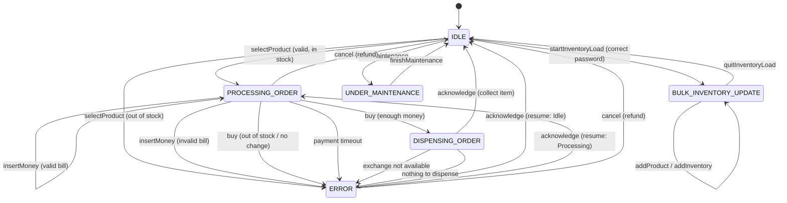

# Vending machine state transitions

## ERROR resume target

`ERROR` is entered through `enterError(type, message, resume)`, and `acknowledge` returns to whatever `resume` produced.

| Raised from | Cause | Continue goes to |
|---|---|---|
| IDLE | out of stock on select | IDLE |
| PROCESSING_ORDER | invalid bill | PROCESSING_ORDER |
| PROCESSING_ORDER | out of stock on buy | IDLE |
| PROCESSING_ORDER | cannot make change | PROCESSING_ORDER |
| PROCESSING_ORDER | payment timeout | IDLE |
| DISPENSING_ORDER | exchange not available | PROCESSING_ORDER |
| DISPENSING_ORDER | nothing to dispense | IDLE |

`cancel` in `ERROR` always releases payment and goes to IDLE, and `ERROR` blocks select, insert, buy, inventory load and maintenance.
